# Dreame Wet & Dry Dashboard

[](https://my.home-assistant.io/redirect/hacs_repository/?owner=matanmesika&repository=dreame-device-card&category=plugin)
[](https://github.com/matanmesika/dreame-device-card/releases/latest)

A Home Assistant dashboard card for **Dreame Wet & Dry** floor washers (H15 Pro Heat and H14). It follows the Dreamehome app: the same tabs, in the same order, with the same names, in English or Hebrew.

## Dashboard screenshots

Captured from the shipping card using the entity states of a real H15 Pro Heat in Home Assistant, at a fixed card height (`height: 720`).

### Tabs (same order and names as the Dreamehome app)

| Mopping Mode | Washing and Drying Settings |
| :---: | :---: |
| 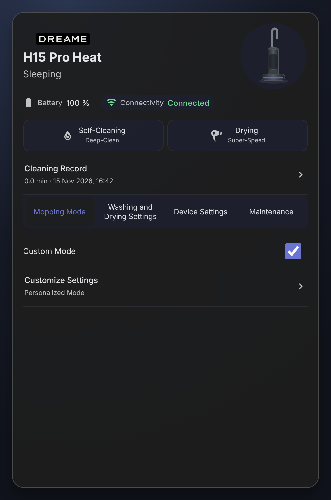 | 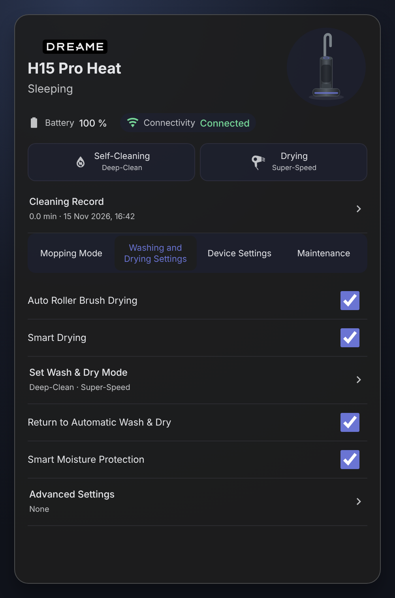 |

| Device Settings | Maintenance |
| :---: | :---: |
| 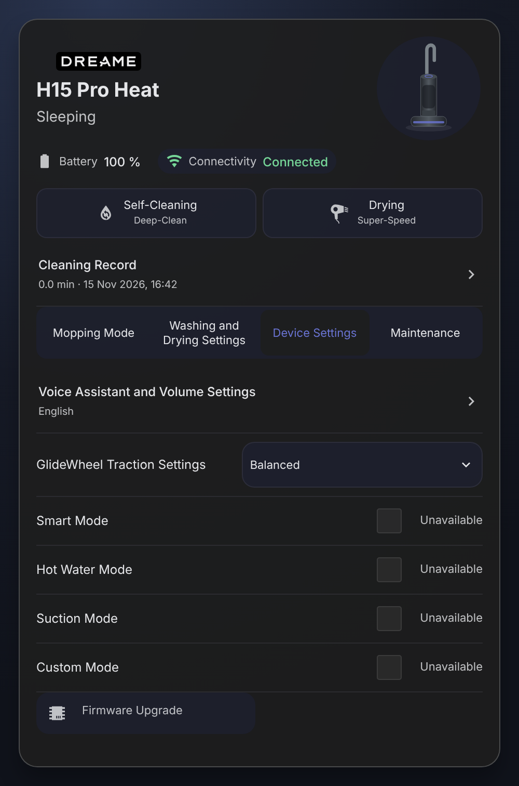 | 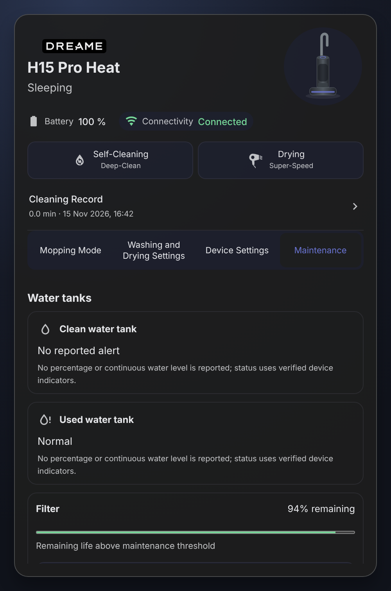 |

### Pages inside the tabs

| Customize Settings | Set Wash & Dry Mode | Advanced Settings |
| :---: | :---: | :---: |
| 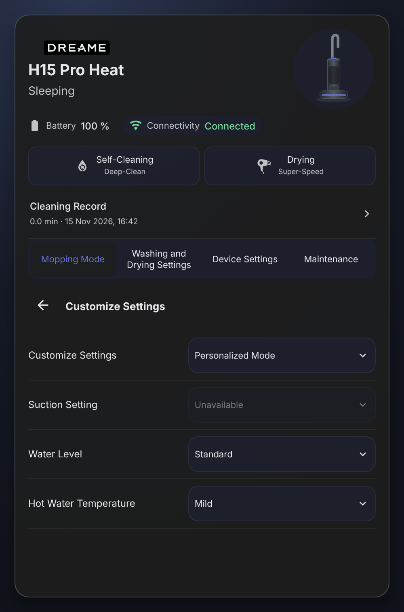 | 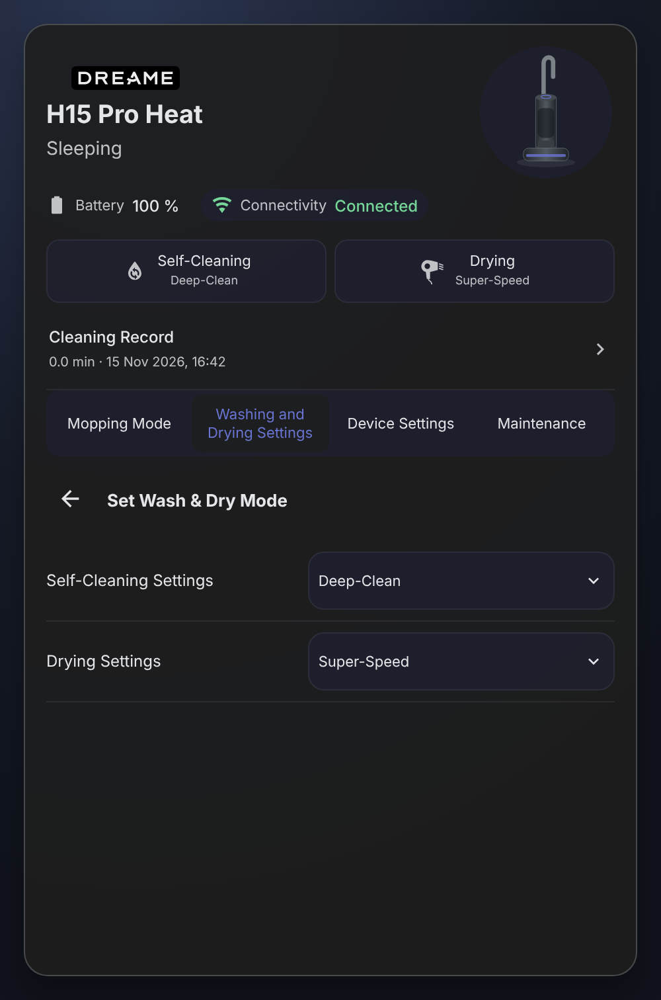 | 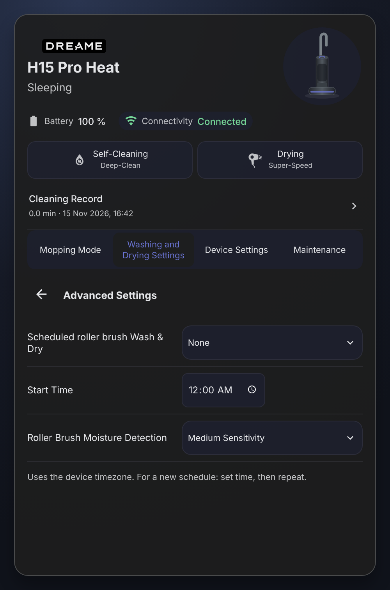 |

| Voice Assistant and Volume Settings | Cleaning Record |
| :---: | :---: |
| 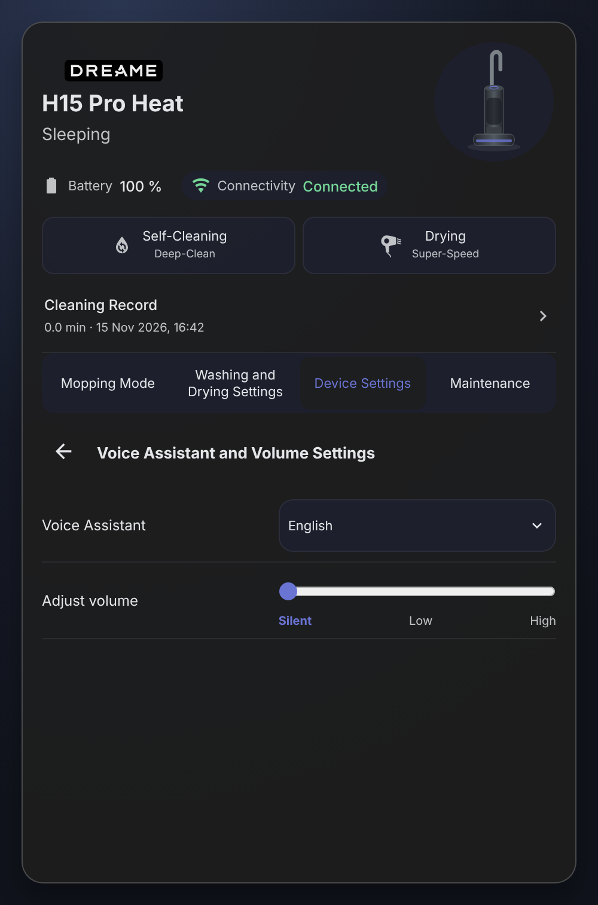 | 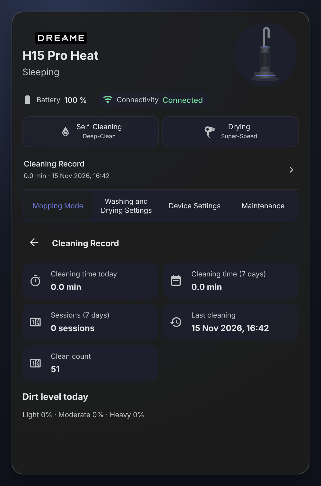 |

### Hebrew interface (`language: he`)

| מצב ניגוב | הגדרות שטיפה וייבוש | תחזוקה |
| :---: | :---: | :---: |
| 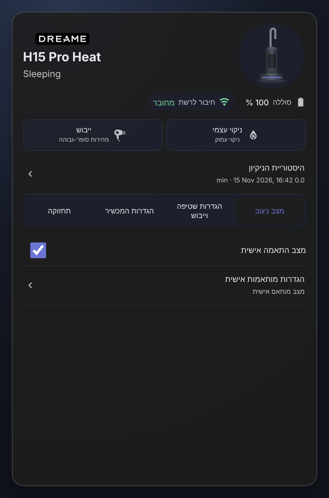 | 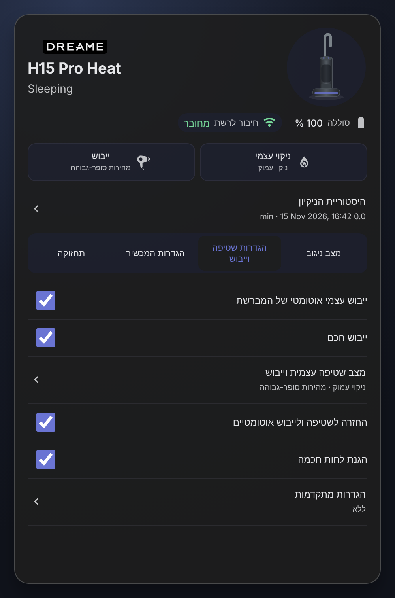 | 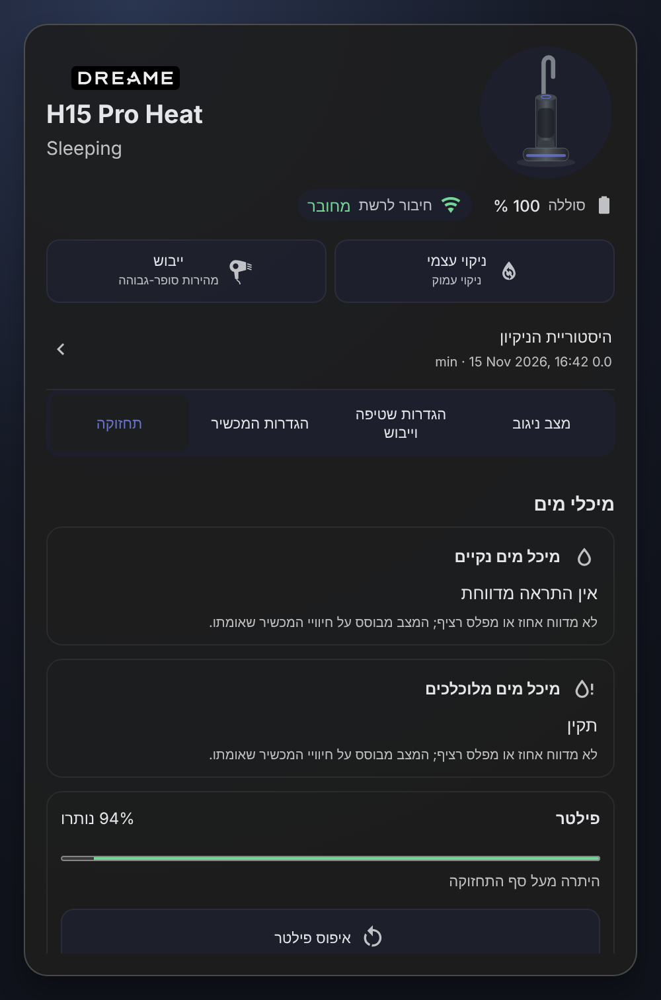 |

### Light theme and H14

| Light theme | H14 |
| :---: | :---: |
| 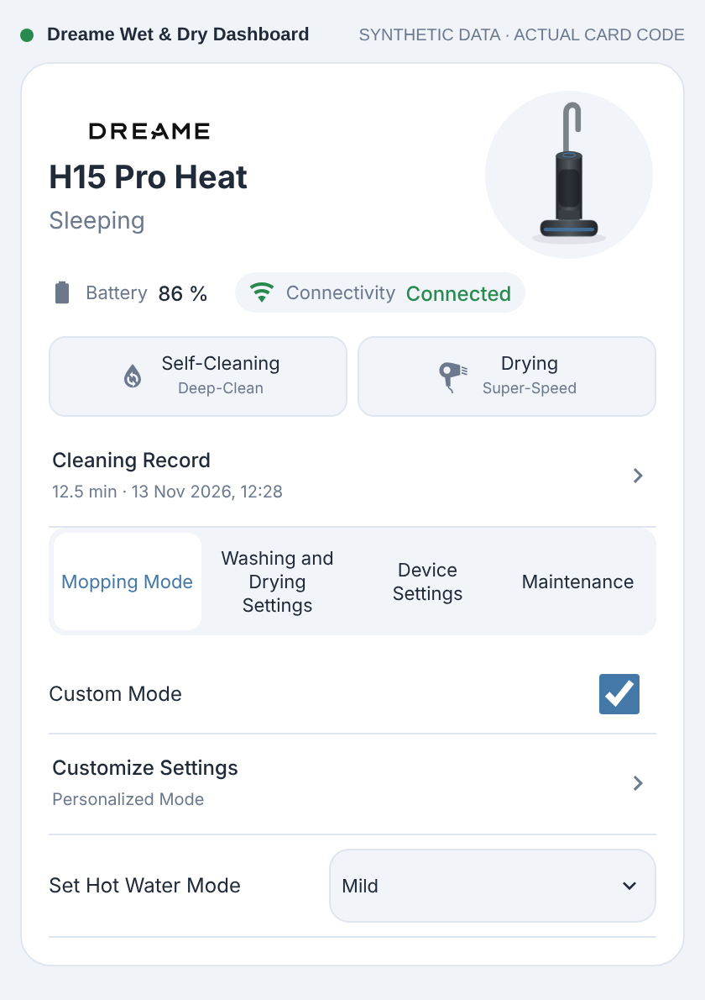 | 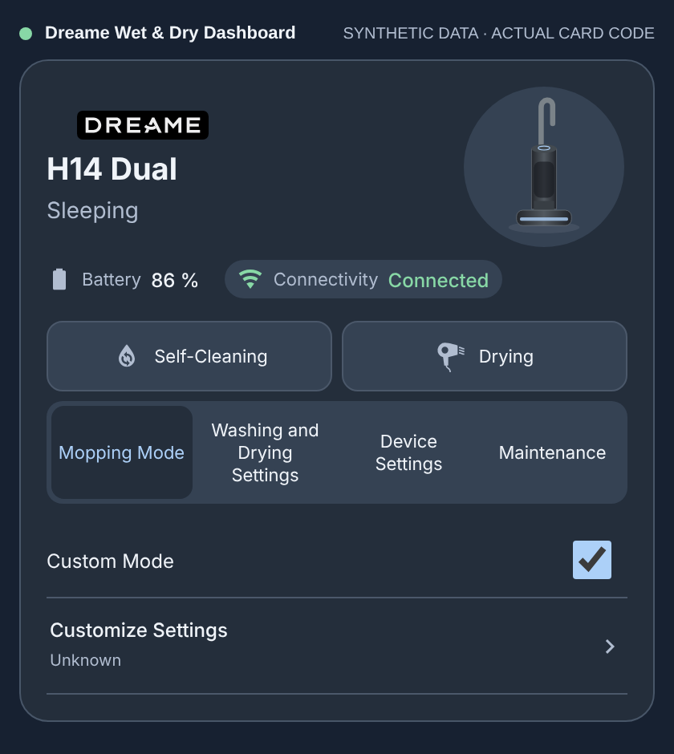 |

The light-theme and H14 images use sample values from [the browser capture test](tests/render_demo_gallery.cjs). What the card shows always depends on the entities your integration provides.

## What the card does

- **Header:** model name, current activity, battery, connectivity, and one-tap **Self-Cleaning** and **Drying** buttons with the current wash and dry modes.
- **Cleaning Record:** cleaning time today and over 7 days, sessions and the last cleaning.
- **Mopping Mode:** custom mode, suction, water level and hot-water settings.
- **Washing and Drying Settings:** auto roller-brush drying, smart drying, wash and dry modes, return-to-wash, moisture protection and the wash & dry schedule.
- **Device Settings:** voice assistant and volume, GlideWheel traction, lifting-arm modes and firmware upgrade.
- **Maintenance:** clean and dirty water tanks, filter and roller-brush life, with confirmed reset buttons.

The card only shows Home Assistant entities that already exist. It never talks to the Dreame cloud, creates sensors or guesses values. A command is sent only after you confirm it, and controls are disabled while the device is offline.

## Requirements

The **[Dreame Wet & Dry integration](https://github.com/matanmesika/dreame-wet-dry-vacuum-home-assistant)**, installed and connected to your device. The card reads that integration's entities.

## Installation

### HACS (recommended)

[](https://my.home-assistant.io/redirect/hacs_repository/?owner=matanmesika&repository=dreame-device-card&category=plugin)

1. Click the button above, or in **HACS → ⋮ → Custom repositories** add `https://github.com/matanmesika/dreame-device-card` with type **Dashboard**.
2. Find **Dreame Wet & Dry Dashboard** in HACS and choose **Download**.
3. Reload the browser (on the phone app: close and reopen it).

HACS adds the resource `/hacsfiles/dreame-device-card/dreame-device-card.js` for you. Updates appear in HACS whenever a new release is published.

### Manual

Copy `dist/dreame-device-card.js` to `<config>/www/dreame-device-card.js`, then add `/local/dreame-device-card.js` as a **JavaScript module** under **Settings → Dashboards → ⋮ → Resources**. Don't register both the manual and the HACS resource.

## Setup

### Automatic (recommended)

Add the card from the dashboard editor (**Add card → Dreame Wet & Dry Dashboard**), or with this YAML:

```yaml
type: custom:dreame-device-card
model: H15        # H15, H14 or auto
language: en      # en or he; leave out to follow Home Assistant
height: 720       # optional: fixed card size, content scrolls inside
```

The card finds your Dreame device in the device registry and connects every part of the card to that device's entities by their unique ID. It keeps working after you rename entities. With more than one Dreame of the same model, pick one with `device_id` (the visual editor lists them).

### Manual (visual editor or YAML)

Open the card's visual editor to set the title, language, model, device and **fixed card height**. Under **Entities** you can override any entity, grouped as *Status*, *Water tanks*, *Maintenance* and *Operation*. Anything left on *Automatic* stays connected to the device.

```yaml
type: custom:dreame-device-card
model: H15
device_id: 0123456789abcdef0123456789abcdef   # Settings → Devices → your Dreame → ID in the URL
title: H15 Pro Heat
language: he
height: 720
entities:
  battery: sensor.h15_pro_heat_battery
  filter: sensor.h15_pro_heat_filter_life
  suction: select.h15_pro_heat_suction_setting
```

With a device selected, controls (buttons, selects, switches, numbers) must belong to that Dreame. Read-only sensors can come from anywhere, for example a template sensor.

### Options

| Option | Default | Description |
| --- | --- | --- |
| `model` | `H15` | `H15`, `H14` or `auto` (detect from the device). |
| `device_id` | automatic | The Home Assistant device to show. Needed only with two devices of the same model. |
| `title` | device name | Heading shown above the activity. |
| `language` | Home Assistant language | `en` or `he`. |
| `height` | automatic | Fixed card height in pixels. Every tab keeps the same size and the content scrolls inside. Leave it out to let the card grow with each tab. |
| `image` | built-in drawing | A `/local/…` or `/hacsfiles/…` picture for the round device badge. |
| `entities` | automatic | Per-role overrides (see below). |

### Entities the card uses

Every role is optional. A missing entity hides its row instead of showing a wrong value. The **H14** column marks roles the H14 profile also uses.

<details><summary><b>Status</b></summary>

| Role | Domain | Shown as | H14 |
| --- | --- | --- | :---: |
| `battery` | sensor | Battery | ✓ |
| `work` | sensor | Current activity | ✓ |
| `online` | binary_sensor | Connectivity | ✓ |
| `charging` | binary_sensor | Charging | ✓ |
| `clean_progress` / `dry_progress` | sensor | Self-cleaning / drying progress | ✓ |
| `clean_count` / `runtime` | sensor | Clean count / total working time | ✓ |
| `clean_today` / `clean_week` / `clean_sessions` / `last_clean` | sensor | Cleaning Record | |
| `firmware` | update | Firmware Upgrade | |
</details>

<details><summary><b>Water tanks</b></summary>

| Role | Domain | Shown as | H14 |
| --- | --- | --- | :---: |
| `clean_empty`, `clean_empty_error` | binary_sensor | Clean water shortage alert | ✓ |
| `dirty_full` / `dirty_missing` / `dirty_cleaning` / `dirty_blocked` | binary_sensor | Dirty tank full / missing / needs cleaning / blocked | ✓ (not blocked) |
| `dirty_tank_status` | sensor | Dirty tank status | |
| `warnings` / `errors` | sensor | Raw warning and error codes | ✓ |
</details>

<details><summary><b>Maintenance</b></summary>

| Role | Domain | Shown as | H14 |
| --- | --- | --- | :---: |
| `filter` / `brush` | sensor | Filter / roller-brush life (% when the integration reports it) | ✓ |
| `filter_worn` / `brush_worn` | binary_sensor | Wear alerts | |
| `reset_filter` / `reset_brush` | button | Reset buttons (always confirmed first) | |
</details>

<details><summary><b>Operation</b></summary>

| Role | Domain | Shown as | H14 |
| --- | --- | --- | :---: |
| `start_clean` / `resume_clean` / `stop_clean` | button | Self-Cleaning | ✓ (start) |
| `start_dry` / `stop_dry` | button | Drying | ✓ (start) |
| `custom`, `mode` | switch, select | Custom Mode, Customize Settings | ✓ (custom) |
| `suction` / `water` / `hot_water` / `temperature` | select | Suction, water level, hot water | ✓ (suction, water) |
| `wash_mode` / `dry_mode` | select | Self-Cleaning and Drying settings | |
| `auto_wash` / `auto_dry` / `smart_dry` / `protection` / `timed_dry` | switch | Washing and drying switches | ✓ (auto_wash, auto_dry, timed_dry) |
| `return_wash` / `return_dry` / `scheduled_wash` / `scheduled_dry` / `repeat` | select | Return and scheduled wash & dry | |
| `schedule_time` | number | Schedule start time | |
| `traction` / `detergent` / `moisture` | select | GlideWheel traction, solution ratio, moisture detection | ✓ (traction) |
| `arm`, `arm_smart` / `arm_hot` / `arm_suction` / `arm_custom` | select, switch | Lifting robotic arm | |
| `language` / `volume` | select, number | Voice assistant and volume | ✓ (volume) |
</details>

## Troubleshooting

- **"Loading device…" never ends:** the integration isn't loaded, or no device matches `model`. Pick the device in the editor or set `model: auto`.
- **A row is missing:** your integration doesn't provide that entity, or it's disabled. Enable it under *Settings → Entities*, or map another entity in the editor.
- **The card is too tall or too short:** set `height` (for example `720`). The tab content scrolls inside the card.
- **An old version still shows after an update:** reload the browser, or close and reopen the phone app.

## Compatibility

- **H15 Pro Heat** (`dreame.hold.w2449e`): full layout. Mapped against the Dreamehome app.
- **H14** (`dreame.hold.w2306e`): Mopping Mode, Maintenance and the common controls.

## Brand

The Dreame wordmark comes from [Wikimedia Commons](https://commons.wikimedia.org/wiki/File:Logo_of_Dreame.svg) (CC BY-SA 4.0, credited to Dreame Technology). This is an unofficial project, not affiliated with Dreame. Dreame's trademarks belong to their owner.

---

## עברית — בקצרה

כרטיס דשבורד ל־Home Assistant עבור שוטפי Dreame Wet & Dry (H15 Pro Heat ו־H14). הלשוניות והשמות זהים לאפליקציית Dreamehome, בעברית או באנגלית (`language: he`).

**התקנה:** HACS → Custom repositories → `https://github.com/matanmesika/dreame-device-card` (סוג Dashboard) → Download, ואז רענון הדפדפן.

**הגדרה אוטומטית:** מוסיפים את הכרטיס, והוא מזהה לבד את המכשיר ואת כל הישויות שלו. **הגדרה ידנית:** בעורך הוויזואלי אפשר לבחור מכשיר, שפה, כותרת, **גובה קבוע לכרטיס**, וכל ישות בנפרד.

**גובה קבוע:** `height: 720` שומר על אותו גודל כרטיס בכל הלשוניות, והתוכן נגלל בתוכו.

נדרשת האינטגרציה [Dreame Wet & Dry](https://github.com/matanmesika/dreame-wet-dry-vacuum-home-assistant). הכרטיס לא יוצר חיישנים ולא פונה לענן. הוא מציג רק ישויות קיימות.
